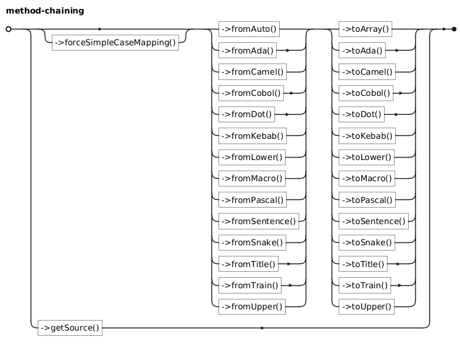

# API reference

`Convert` stores the source string and the words extracted from it. Construct
it with the string to convert; the format is detected automatically unless you
select a splitter with a `from*()` method. Conversion methods return strings.

```php
use Jawira\CaseConverter\Convert;

$convert = new Convert('first-name');
$convert->toCamel(); // firstName
```

`Convert` is immutable with respect to its source string: `getSource()` always
returns the original input. `from*()` methods update the detected words on the
same instance and return that instance, so calls can be chained.

## `Jawira\CaseConverter\Convert`

This diagram displays all the chaining possibilities:



### Conversion methods

| Method         | Output format | Example (`my name is bond`) |
|----------------|---------------|-----------------------------|
| `toCamel()`    | Camel case    | `myNameIsBond`              |
| `toPascal()`   | Pascal case   | `MyNameIsBond`              |
| `toSnake()`    | Snake case    | `my_name_is_bond`           |
| `toAda()`      | Ada case      | `My_Name_Is_Bond`           |
| `toMacro()`    | Macro case    | `MY_NAME_IS_BOND`           |
| `toKebab()`    | Kebab case    | `my-name-is-bond`           |
| `toTrain()`    | Train case    | `My-Name-Is-Bond`           |
| `toCobol()`    | Cobol case    | `MY-NAME-IS-BOND`           |
| `toLower()`    | Lower case    | `my name is bond`           |
| `toUpper()`    | Upper case    | `MY NAME IS BOND`           |
| `toTitle()`    | Title case    | `My Name Is Bond`           |
| `toSentence()` | Sentence case | `My name is bond`           |
| `toDot()`      | Dot notation  | `my.name.is.bond`           |

### Input format methods

These methods tell the converter how to split the original source string. They
return the same `Convert` instance. Delimited formats split on one or more of
the named delimiter characters; camel and Pascal formats split before each
uppercase letter.

| Method(s)                                                     | Splitting rule                                                            |
|---------------------------------------------------------------|---------------------------------------------------------------------------|
| `fromAuto()`                                                  | Detect the format using the [detection algorithm](detection-algorithm.md) |
| `fromCamel()`, `fromPascal()`                                 | Before uppercase letters                                                  |
| `fromSnake()`, `fromAda()`, `fromMacro()`                     | Underscores (`_`)                                                         |
| `fromKebab()`, `fromTrain()`, `fromCobol()`                   | Hyphens (`-`)                                                             |
| `fromLower()`, `fromUpper()`, `fromTitle()`, `fromSentence()` | Spaces                                                                    |
| `fromDot()`                                                   | Dots (`.`)                                                                |

The names in each row use the same splitting rule; the source's capitalization
does not affect how words are split.

`fromAuto()` accepts an optional `$digitsAreLowercase` argument, which defaults
to `true`. With the default, digits are grouped with lowercase text when
detecting uppercase-only input. Set it to `false` to treat digits like
uppercase letters for this check.

### Utility methods

| Method                     | Description                                                                                         |
|----------------------------|-----------------------------------------------------------------------------------------------------|
| `getSource()`              | Return the original input string.                                                                   |
| `toArray()`                | Return the currently detected words as an array of strings.                                         |
| `forceSimpleCaseMapping()` | Use simple rather than full Unicode case mapping for subsequent conversions; returns this instance. |

## `Jawira\CaseConverter\CaseConverter`

The `CaseConverter` class is a factory, it only contains a single method.

| Method                                        | Description                      | 
|-----------------------------------------------|----------------------------------|
| `Jawira\CaseConverter\CaseConverter::convert` | Create a new `Convert` instance. | 

See [Using the factory](using-the-factory.md) for more details.
