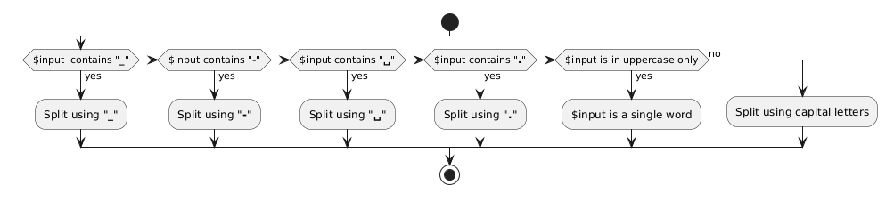

Automatic format detection
==========================

When a `Convert` object is created, the library splits the source string into
words. `fromAuto()` reruns this detection on the original source. Detection
chooses the first matching rule below:

1. If the string contains an underscore (`_`), split on one or more underscores.
2. Otherwise, if it contains a hyphen (`-`), split on one or more hyphens.
3. Otherwise, if it contains a space (`␣`), split on one or more spaces.
4. Otherwise, if it contains a dot (`.`), split on one or more dots.
5. Otherwise, if the whole string contains only uppercase letters, treat it as
   one word.
6. Otherwise, split before every uppercase letter.

The diagram below illustrates the detection order.

The order matters. For example, if a string contains both underscores and
hyphens, automatic detection uses underscores and leaves hyphens inside the
resulting words. Choose an explicit `from*()` method when the source format is
known or when the automatic result is not what you want.

!!! tip

    By default, digits count like lowercase characters in the uppercase-only
    check. For example, `fromAuto()` treats `ABC123` as one word. Pass `false` to
    `fromAuto(false)` to count digits like uppercase characters in that check.
    This option affects only automatic detection of uppercase-only strings.
