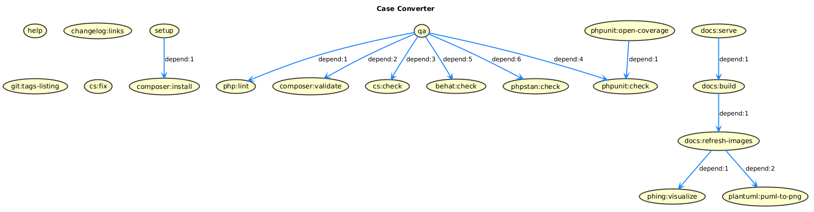
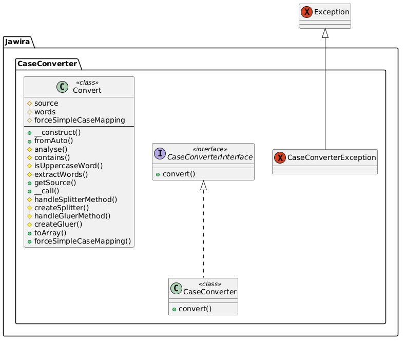
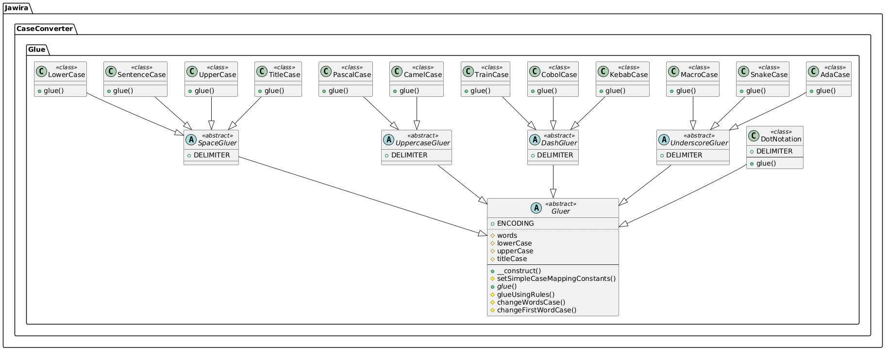
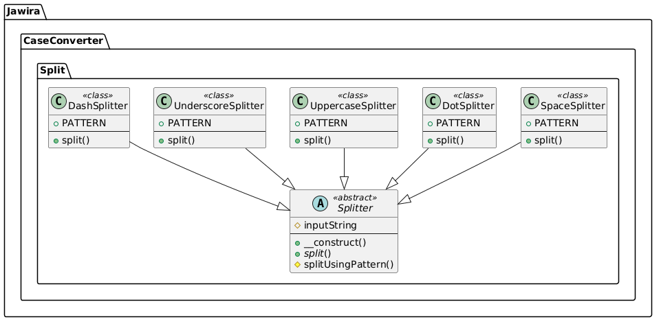

Development notes
=================

Phing targets
-------------

- `phing setup`: Install the Composer dependencies.
- `phing qa`: Run the configured PHP lint, style, unit, behavior, and static-analysis checks.

Documentation
-------------

The documentation site is built with MkDocs. To build it locally, install
MkDocs with the Material theme, then run `phing docs:build`. To preview changes
while editing, run `phing docs:serve`.

`docs:build` also refreshes generated diagrams, so the project's development
dependencies must be installed first.

Using Phing behind a proxy
--------------------------

If you are developing behind a proxy, configure the `http_proxy` environment
variable. `build.xml` passes it to Phing tasks that need it.

Creating new convention
-----------------------

1. Create new Gluer class.
2. Create new Split class.
3. Update `\Jawira\CaseConverter\Convert::analyse` if needed.
4. Register into `\Jawira\CaseConverter\Convert::handleSplitterMethod`.
5. Register into `\Jawira\CaseConverter\Convert::handleGluerMethod`.
6. Update docblock `\Jawira\CaseConverter\Convert` to register new methods.
7. Update documentation.

Class diagrams
--------------

[git-flow]: https://github.com/petervanderdoes/gitflow-avh

[Keep a changelog]: http://keepachangelog.com/en/1.0.0/

[mkdocs]: https://www.mkdocs.org/#installation

[mkdocs-material]: https://github.com/squidfunk/mkdocs-material

[pds/skeleton]: https://github.com/php-pds/skeleton

[Phive]: https://phar.io/

[Semantic Versioning]: http://semver.org/

[Composer]: https://getcomposer.org/
