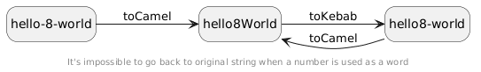

# Behavior and limitations

## Digits and word boundaries

Digits are not treated as word separators. In automatic detection, digits are
also treated like lowercase characters by default when checking whether an
input consists only of uppercase letters. This can make strings containing
digits split differently than expected:

```php
use Jawira\CaseConverter\Convert;

(new Convert('REEL2REAL'))->toDot(); // r.e.e.l2.r.e.a.l
(new Convert('reel2real'))->toDot(); // reel2real
(new Convert('Reel2Real'))->toDot(); // reel2.real
```

For example, `hello8World` converts to `hello8-world` in kebab case. The
converter cannot infer that the `8` should have been a separate word. If a
particular split is required, preprocess the input to add a separator where
needed.



## Acronyms and mixed capitalization

The converter splits before every uppercase letter in unseparated input. It
does not infer acronym boundaries.

For example, `XMLHttpRequest` is split as
`X`, `M`, `L`, `Http`, `Request`, and converts to `x.m.l.http.request` in dot
notation. If the intended words are `Xml`, `Http`, and `Request`, write the
input as `XmlHttpRequest`.

| ❌ Wrong        | ✅ Good          |
|-----------------|------------------|
| PHP_CodeSniffer | php_code_sniffer |
| PHP_CodeSniffer | PhpCodeSniffer   |
| PHPUnit         | PhpUnit          | 
| PHPUnit         | php-unit         |

Use consistent separators and capitalization in the source. For example,
`PHP_CodeSniffer` mixes an acronym with an underscore-separated name, while
`php_code_sniffer` and `PhpCodeSniffer` have unambiguous boundaries.

!!! note "Acronyms in PHP"

    This acronym problem has also affected PHP's own class naming conventions. A
    2024 [PHP RFC on acronym casing](https://wiki.php.net/rfc/class-naming-acronyms)
    was accepted to treat acronyms and initialisms like regular words in Pascal
    case: for example, prefer `HttpRequest` over `HTTPRequest`. The RFC updates
    PHP's policy for internal classes; it does not rename existing classes. This
    mixed-case style also makes word boundaries easier for Case Converter to
    detect.
